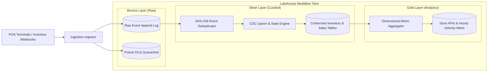

# Retail Lakehouse Ingestion Engine

[](https://github.com/itsoumya-d/retail-lakehouse-ingestion-engine/actions/workflows/ci.yml)
[](https://www.python.org/downloads/)
[](https://opensource.org/licenses/MIT)

High-throughput retail POS transaction ingestion, CDC event normalization, and Medallion architecture (Bronze -> Silver -> Gold) transformation pipeline in Python.

---

## 1. Architecture Overview



---

## 2. Medallion Tiers

- **Bronze Layer**: Raw event batching, schema validation, and poison message quarantine for malformed payloads.
- **Silver Layer**: Idempotent deduplication via payload hashing, Change Data Capture (CDC) upsert, and ISO datetime standardization.
- **Gold Layer**: Dimensional aggregations, hourly sales velocity, inventory depletion metrics, and store KPIs.

---

## 3. Quickstart

### Local Setup

```bash
# Clone repository
git clone https://github.com/itsoumya-d/retail-lakehouse-ingestion-engine.git
cd retail-lakehouse-ingestion-engine

# Run test suite
pytest -v
```

### Pipeline Usage

```python
from engine import RetailLakehouseEngine, POSTransactionEvent

engine = RetailLakehouseEngine()

# Process incoming POS transaction batch
event = POSTransactionEvent(
    event_id="tx_1001",
    store_id="store_akl_01",
    terminal_id="term_03",
    timestamp="2026-11-26T05:30:00Z",
    items=[{"sku": "SKU-992", "qty": 2, "price": 45.00}],
    total_amount=90.00
)

report = engine.process_batch([event])
print(f"Processed: {report.processed}, Quarantined: {report.quarantined}")
```

---

## 4. Testing

The test suite validates data quality contracts, schema conformance, idempotency, and aggregation logic:

```bash
pytest -v
```
